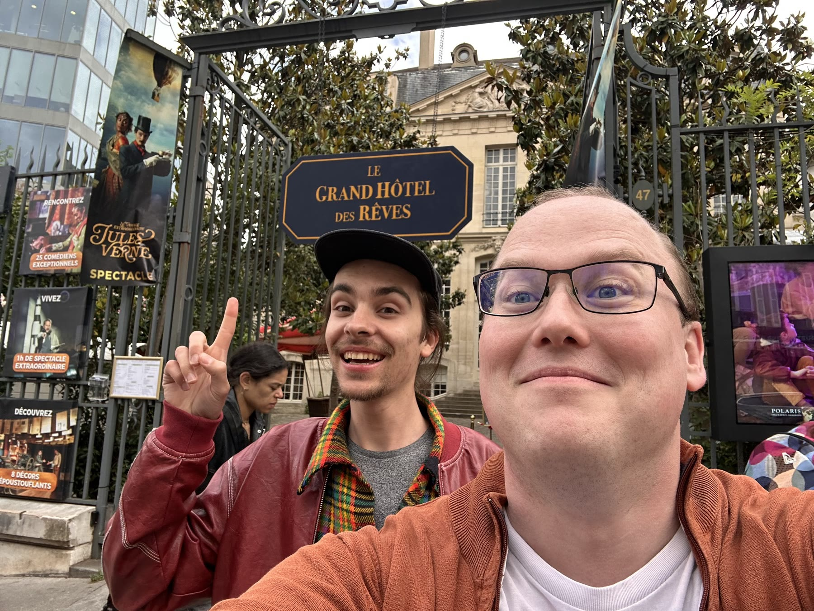
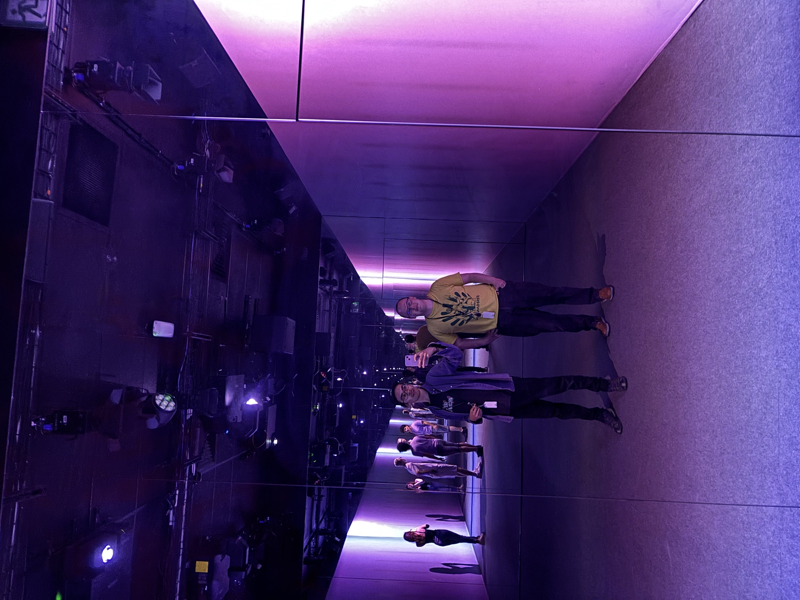

We went on a couple of field trips to see how others deal with immersive experiences: [Le Grand Hôtel des Rêves](https://www.legrandhoteldesreves.fr/spectaclejulesverne), and [TOI](https://toi.wearemoir.com/paris/en/), an immersive personality test by Moir. We paid close attention to thresholds, lighting, costumes, hosts, and the roles visitors play.

## Le Grand Hôtel des Rêves

[Le Grand Hôtel des Rêves](https://www.legrandhoteldesreves.fr/spectaclejulesverne) is an immersive show in a historic house in the 5th arrondissement. In small groups you move from room to room, led by the inhabitants of the hotel, through the worlds of Jules Verne: the Nautilus, the rocket, and the other sets.

We were impresed by the location of Le Grand Hôtel des Rêves but noted the conventional stage light design and division between performers and audience in many of the setpieces. There was one room that had clouds on the ceiling. 

## TOI

[TOI](https://toi.wearemoir.com/paris/en/) is Moir’s immersive personality test, in their space on boulevard Saint-Jacques. For about ninety minutes you move, play and choose across a series of rooms, guided by a virtual avatar. Those choices shape an Aura, revealed in a holographic show at the end. You log your choices via a user tag that you carry with you. 

This was a slighty tacky pop-psychology take on cognitive science concepts mixed with the alternative lifestyle concept of aura but the actual production values were pretty high end. Probably a great place to take a date or to go with family. There was an interesting social dynamic where we could publicly see what other people were choosing directly in a context where these choices were somehow indicating something fundamental about us. It all felt a bit like a gameshow and one part of the exhibition was framed exactly like a gameshow. 

## Other Notes

We also came back to psychology. Michael shared his writing on belonging, including on Maslow and the Blackfoot. Out of that came a simple realisation: **you cannot have this experience without the participants.** If the work is about how people bring belonging to each other, it is deeply relational. It can't just be streamed and understood.

Zéphir also had a [conversation with Joanna Riquett about ritual](../2026-05-19-a-conversation-with-joanna/) that gave us a set of principles we still use.

Other ideas from the week: a mindful train carriage, a bus whose destination you don't know, a barge. And the *Regards connectés* exercise, where two people hold eye contact for a long time. After how long does the experience begin?
