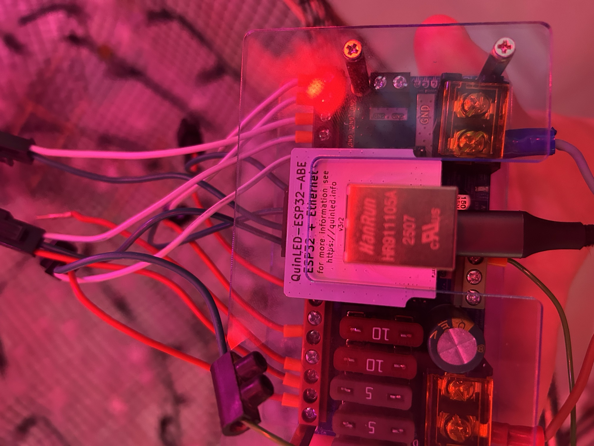
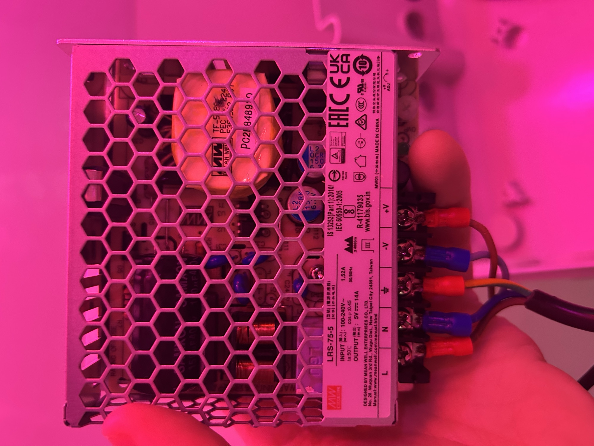

A bigger spheroid cloud with LEDs mapped through its volume. This was to explore how lightning would look over longer distances, and how those flashes would combine with the time-of-day effects.

The controller and power supply were borrowed from the music team in the lab. They had used that gear for live lighting at [Delaurentis’s *Pionnières*](https://delaurentismusic.com/en/pionnieres/). We had not added a battery yet. We later changed our own gear.

The controller is a QuinLED Dig-Quad with a QuinLED-ESP32-ABE module, running the LED data out to the cloud. The supply is a Mean Well LRS-75-5, 5 V at 14 A, feeding that controller.

