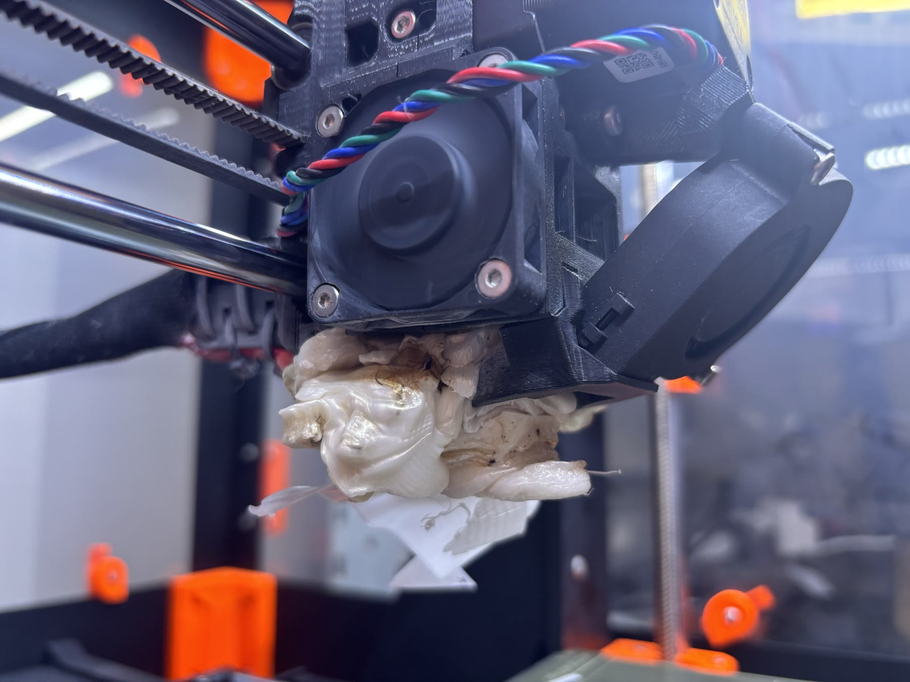
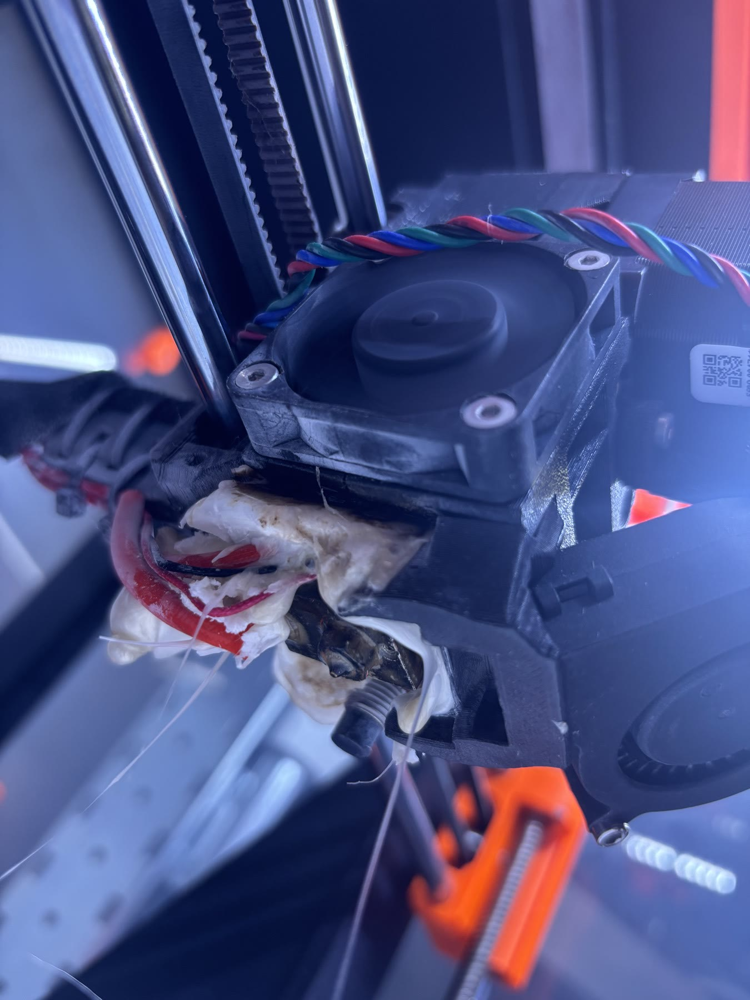

We chose an off-centre pyramid for the internal structure of our cloud. It was a simple shape to build and approximated the cloud structure we had in mind. Zéphir created a 3D model of the pyramid structure from which we create 3D printable joints. 

Below is the model we printed from with additional planes added in Blender to support placement of LEDs during LED mapping. They they stand in for the mesh walls that would be stretched across the frame. Drag to turn it around.

<figure class="model-figure">
  <model-viewer
    src="../../models/pyramid-walled.glb"
    alt="3D model of the pyramid frame: white printed edges and joints, with green planes filling each face where the mesh walls sit"
    camera-controls
    auto-rotate
    shadow-intensity="0.6"
    environment-image="neutral"
    style="display: block; width: 100%; height: min(28rem, 70vw); background: #1b2440; border-radius: 1rem;"
  ></model-viewer>
  <figcaption>The printed frame, with the planes I added for LED mapping.</figcaption>
</figure>

## When the print went wrong

Not everything went to plan. On the printer at Sony CSL Paris, one print failed badly: instead of building up a part, the filament set into a solid blob around the hot end, swallowing the nozzle, the heater wires and part of the print head. 

We were also trying out combining smaller pieces of wood together with dowels and wood glue but this was far too brittle.

