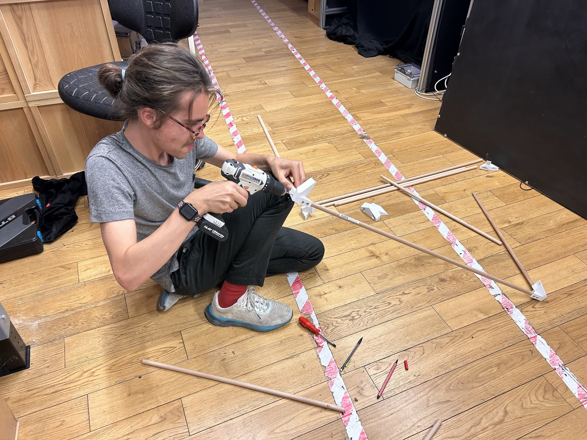
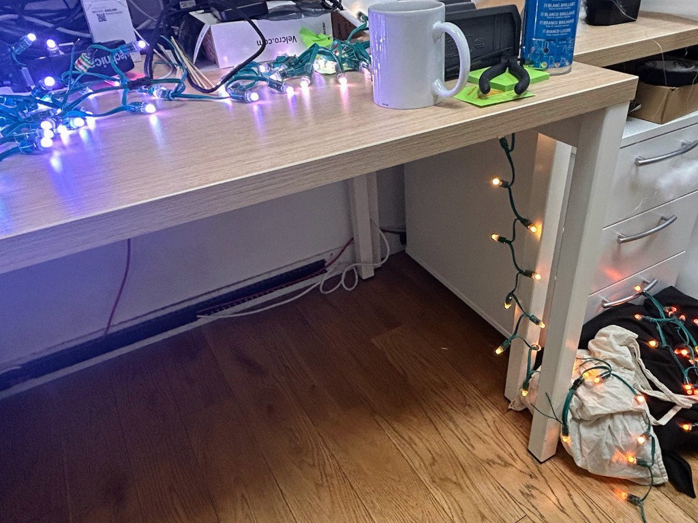

The printed parts from last week turned out to be joints. Wooden dowels slot into them, and together they make a low pyramid: light enough to hang, and easy to take apart again.

## Mesh over the frame

We kept using the same green plastic garden mesh as the first cloud. It was fine. Stretched over the dowels and tied at every edge, it is the skin of the skeleton, and it gives the lights something to hold on to.

Strings of addressable LED pixels are zip-tied across each face in rows, every bulb pointing outwards. I first tried mapping them in the software and then tying each pixel onto the mesh in the same place by hand. The measurements did not quite correspond, so afterwards I did it the other way around: I laid the LEDs on the frame, then adjusted the software mapping to match that physical layout. Each pixel can take its own colour, which is what makes gradients, travelling light and lightning possible. A pyramid places those pixels at different depths inside the cloud, so light can seem to move *through* it rather than across a flat panel.

Without injecting power periodically along the line, 5 V string lights suffer voltage drop: setting all pixels to full white causes the furthest LEDs along the strand to fade into amber and yellow. Injecting power every 100 pixels keeps the voltage steady and colours true across the whole cloud.

