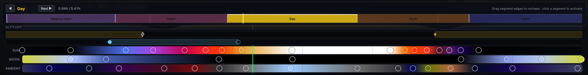
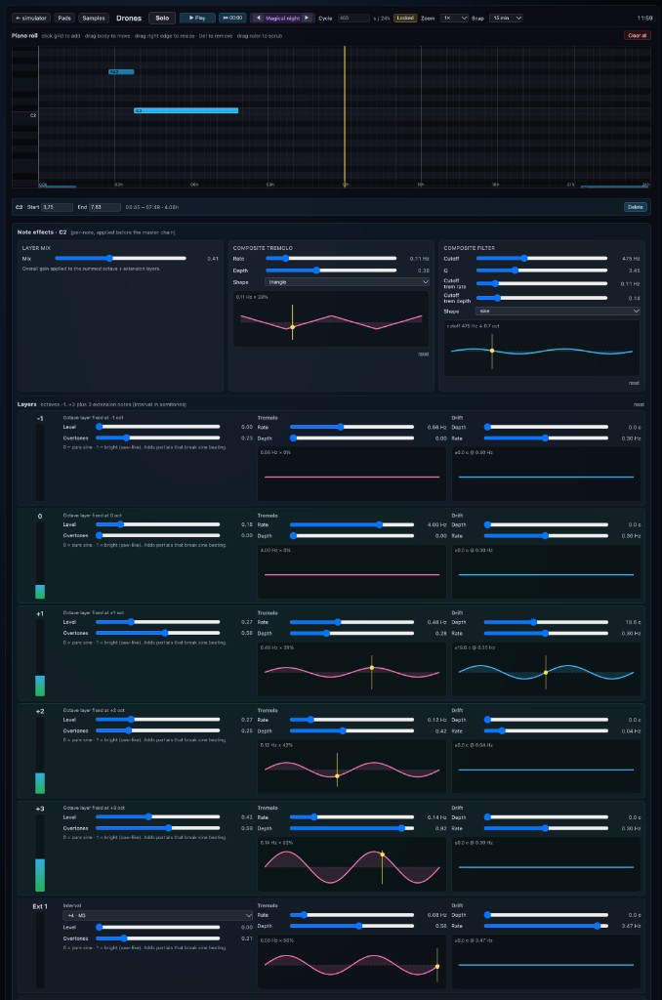
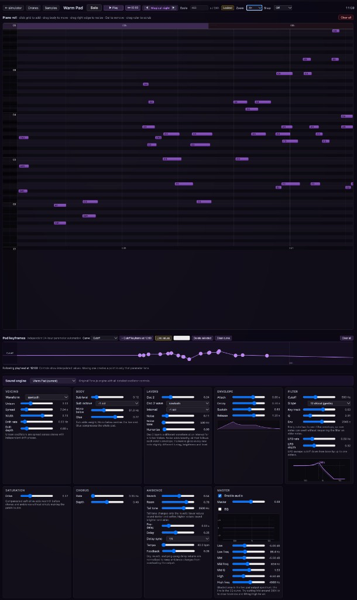
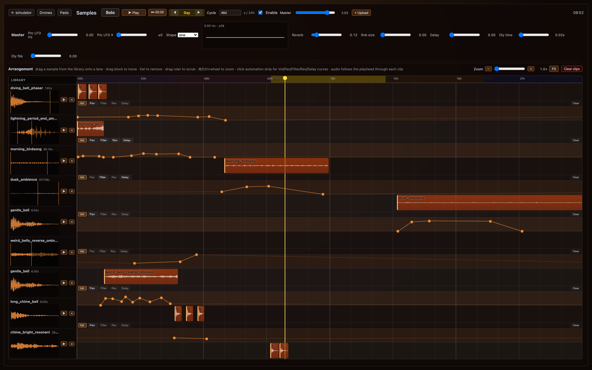

## Composing for a responsive environment

The July draft of Cloudfulness had six movements: dusk, storm, moonlight, shared breath, sunrise and tea. For the pilot installation, we reduced these to three main stages: dusk, magical twilight and breath synchrony.

The score needed to establish a musical progression through these stages while remaining responsive to the participants. We wanted the sound to work alongside the changing light, creating a coherent atmosphere without demanding attention throughout the experience.

This presented a compositional challenge. A fixed soundtrack would give us precise control over the musical narrative, but little room for interaction. Fully generative music would provide flexibility, but risk losing the sense of progression we wanted.

We settled on a combination of synthesised drones, pads and triggered samples, controlled from within the same simulator as the lighting. This allowed us to compose the overall musical structure while leaving individual elements free to respond to events within the installation.

## The musical narrative

### Bells and chimes

Bells provide punctuation throughout the score, marking transitions between periods. We imagined them almost as sounds carried by wind through the cloud: brief events that appear and disappear without forming a conventional melody. They also connect to the Buddhist influences underlying the installation.

### Dusk and the approaching storm

The score begins with a low drone, providing a continuous background beneath the changing light. As the storm approaches, low synthesised tones swell periodically, overlapping with the rumble of thunder.

We kept these sounds relatively sparse. Rather than building a continuous musical crescendo, the swells appear and disappear, leaving space for the thunder and other sounds to emerge.

### Magical twilight

For magical twilight, we wanted something mysterious and slightly unsettling, but without becoming frightening. The transition begins with darker bell sounds, processed with a subtle phaser effect.

Higher-register pads then enter in response to the bells, shifting the composition away from the low, thunder-like swells towards brighter, more sustained sounds.

The score also leaves space for the sprites, whose unusual sounds accompany their visual appearances. Wind chimes and shimmering textures complete the transition into the more melodic final section.

### Breath and the return to daylight

The final movement changes the character of the score. Longer, consonant chords replace the darker textures of magical twilight, creating a more open and settled musical atmosphere.

We chose sustained pads partly because of their relationship with breathing. Their long notes provide a continuous sound that can be gradually shaped, making the effects of breath modulation easier to perceive. The chords swell and recede, leaving space between phrases and allowing other elements of the soundscape to remain audible.

As dawn approaches, birdsong returns, initially with a slightly unfamiliar, processed quality. The synthesised sounds gradually converge on a single sustained note before fading away.

Eventually, only silence remains. The installation returns to the daylight from which it began.

## The cloud as an instrument

One idea we explored was whether the cloud could function as a musical instrument.

In our earlier IFT collaboration, we experimented with web-like structures that respond to touch, proximity and gesture through sound and light. Cloudfulness offered another way to investigate this relationship, using breathing rather than deliberate physical gestures.

Unlike a conventional musical instrument, the cloud requires no learned technique or conscious performance. The participant's breathing becomes an input, altering both the illumination and the soundscape.

<figure>
  <video controls playsinline preload="metadata" src="../../video/audio-breath-modulation.mp4" poster="../../video/audio-breath-modulation.jpg"></video>
  <figcaption>Breath modulating the sound, with audio. Watch the drone, pad and sample controls move as each breath passes through the cloud.</figcaption>
</figure>

As an out-breath travels into the cloud, the simulator measures how much of the cloud becomes illuminated. This value controls a range of audio parameters, including volume, filtering, saturation, tremolo and stereo spread.

Each parameter has a resting value and a target value associated with the cloud being fully illuminated by breath. As the illumination changes, the sound moves smoothly between them.

The drones, pads and samples can therefore respond differently to the same breath. A drone might become brighter, while the pads grow louder and spread across the stereo field. As the light fades, the sounds return towards their resting states.

An important consideration was how strongly the score should respond. Too little modulation and the relationship between breath and sound becomes imperceptible. Too much and the music loses its coherence, turning the experience into an exercise in controlling audio effects.

We wanted participants to recognise that their breathing was changing the environment without needing to concentrate on controlling it.

This is an interesting distinction between playing an instrument and participating in an environment. Breathing is usually something we do without paying much attention to it. By making its consequences audible and visible, the installation creates an opportunity to become aware of an otherwise unnoticed relationship between our bodies and the surrounding space.

For the pilot, we kept this interaction relatively simple, but it remains one of the directions we would like to explore further.

## Building and synchronising the sound system

The score was implemented within the same simulator that controlled the lighting. Both systems followed a shared 24-hour timeline, allowing us to compose and adjust the sound while watching the corresponding changes in the cloud.

The audio system combined several types of sound:

- **Drones:** stacks of sine layers at octaves around a root note, providing the underlying atmosphere.
- **Pads:** chord stacks that blend into each other, with a sub an octave below and a second oscillator an octave above.
- **Samples:** recorded bells, thunder and other sounds triggered at particular moments or by events within the simulation.

*The 24-hour cycle gave the sound a shared structure with the light.*

*A drone note, here C2, built from octave layers around that root.*

A drone is written as one long note, but that note is a stack of frequencies around a root. In the panel above, C2 is held across part of magical twilight. Under it, separate layers sit at fixed octaves: one below the root, the root itself, then one, two and three octaves above, with a further interval for an extra layer. Each layer is a sine at that pitch, with its own level, so the weight of the root against the octaves around it can be set by ear.

Overtones on a layer add partials that stop a pure sine from beating too cleanly. Tremolo and a slow pitch drift on each layer, and again across the whole note, move those nearby frequencies against one another. The result is a chorus around the root rather than a single locked tone. A filter over the summed layers decides how much of that stack is heard.

*A warm-pad chord across magical twilight, with the filter cutoff drawn over the day.*

The pads play chord stacks that blend into each other. To add body to the pads we added a sub an octave below, and a second oscillator an octave above adds another interval. Various other parameters add variability to the character of the pads, like saturation or varying spread and envelope.

I deliberately created this with long chords with space between them for the drone to shine through and other samples, while ensuring notes linger so that the effect of the breath modulation can be more easily understood audibly.

*Bells and other samples marked changes between periods.*

The bell and thunder recordings came from Freesound, while their timing, playback and modulation were controlled by the simulator.

## Connecting lightning and thunder

We wanted lightning and thunder to feel like related events rather than independent effects.

Each lightning event generated by the simulator could trigger a thunder sample selected according to the character of the strike. We tagged recordings by loudness and duration, using low, medium and high intensity categories and short, medium and long durations.

This allowed a brief, relatively weak flash to produce a correspondingly smaller thunder sound, while a larger strike could trigger something longer and more substantial.

We also introduced a configurable delay between the flash and the thunder, reflecting the separation between light and sound in a real storm.

The location of a strike could influence stereo panning, giving the impression of thunder occurring at different positions across the space. Small pitch variations helped prevent repeated samples from sounding identical.

These details were relatively straightforward to implement, but made a considerable difference to how connected the sound and lighting felt.

## Composing within the simulator

Keeping the score inside the simulator allowed us to work on sound and light together rather than treating audio as something added after the visual experience was complete.

We could change the timing of a transition, adjust the character of a drone, or experiment with breath modulation while observing the corresponding lighting behaviour.

The resulting score is neither entirely fixed nor entirely generative. Its musical progression is composed, but its individual elements retain enough flexibility to respond to the installation.

For us, this balance was essential. We wanted the sound to give the experience structure while allowing the participants, through something as simple as breathing, to become part of what they were hearing.
